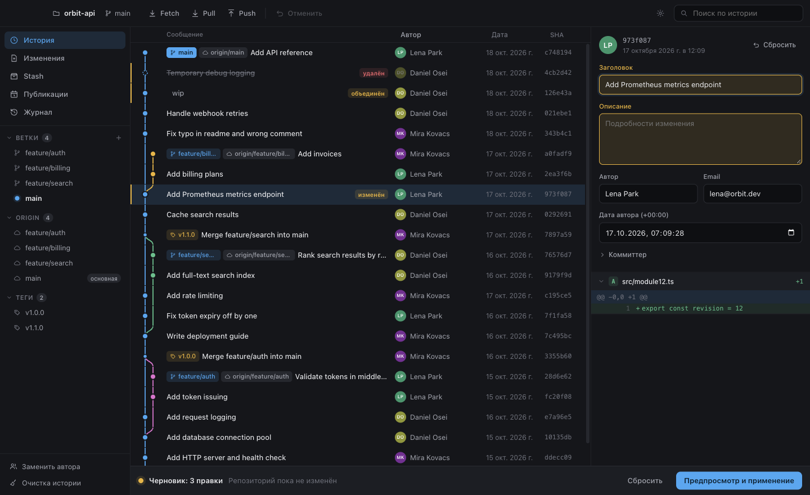

<p align="center">
  
</p>

<h1 align="center">Chronicle</h1>

<p align="center">
  <b>A visual Git history editor for macOS and Windows.</b><br>
  Rewrite, reorder, squash and schedule commits. See every change before it happens, and undo it afterwards.
</p>

<p align="center">
  <a href="https://github.com/betrayalove/git-gui/releases/latest"></a>
  <a href="https://github.com/betrayalove/git-gui/actions/workflows/ci.yml"></a>
  
</p>

<p align="center">
  <b>English</b> · <a href="README.ru.md">Русский</a>
</p>

<picture>
  <source media="(prefers-color-scheme: dark)" srcset="docs/images/history-dark.png">
  <source media="(prefers-color-scheme: light)" srcset="docs/images/history-light.png">
  
</picture>

## Why Chronicle

Interactive rebase is powerful, but you edit a text file and learn the result afterwards. Chronicle lets you work on the history itself. Edits collect in a draft, the repository stays untouched, and a preview shows exactly which commits, branches and tags will change before anything moves.

## Features

### Edit history

- **Change any commit:** message, author, committer and dates, including commits you have already pushed.
- **Reorder** commits by dragging them.
- **Squash, drop and split** commits. Splitting works hunk by hunk.
- **Replace an author** across the whole history.
- **Clean history:** remove files from every commit, or collapse a branch into one commit.
- **Resolve conflicts** caused by a new commit order right in the preview.

### Stay safe

- **Nothing changes until you apply.** The preview builds the real new history without moving any branch.
- **Atomic updates.** All branches and tags move together, or none of them do.
- **Undo and redo.** Every rewrite is kept in a journal with backups.
- **Protected force-push.** It uses `--force-with-lease`, so commits someone else pushed meanwhile are not overwritten. You see what appears and what vanishes on the server first.
- **Exact history.** Commits you did not touch keep their bytes and SHA, and old or unusual objects survive a rewrite. This was checked on the full history of `git/git`.

### Publish later

Take the latest commits off a branch, locally and on the server, and publish them at a set time. Chronicle waits in the tray, and checks in advance whether the server will accept the push with nobody at the computer.

### Everyday Git

Commit, push, pull and fetch. Stage individual hunks. Manage stashes, branches and tags, including renaming a branch on the server. Cherry-pick, revert and reset. Compare changes in a built-in diff view.

### No account needed

Chronicle works through your system Git and the SSH keys on your computer. Local work needs nothing at all. When a server refuses the connection, a helper takes over:

1. It uses a key that already works, with any file name.
2. It asks for the key's password if the key has one.
3. If no key fits, it creates one and walks you through adding it on GitHub or GitLab.

Pull and merge requests open on the site with the branch already selected.

## Screenshots

| Preview before applying | Publish on a timer |
| --- | --- |
|  |  |

| Connecting with an SSH key |
| --- |
|  |

The interface is currently in Russian.

## Download

Get the latest version from [Releases](https://github.com/betrayalove/git-gui/releases/latest). Chronicle needs [Git](https://git-scm.com/downloads) 2.45 or newer.

| System | Installer | Portable, no installation |
| --- | --- | --- |
| **Windows** x64 | `…-windows-x64-setup.exe` | `…-windows-x64-portable.exe`, `…-windows-x64-portable.zip` |
| **macOS** Apple silicon | `…-macos-arm64.dmg` | `…-macos-arm64-portable.zip` |
| **macOS** Intel | `…-macos-x64.dmg` | `…-macos-x64-portable.zip` |

The portable `.exe` keeps its data in a `Chronicle Data` folder next to the file. Starting it takes a little longer, because it unpacks itself each time.

### First launch

Builds are not signed with a paid developer certificate yet, so the system warns about them. Updates are announced in the app and installed by hand.

- **macOS:** open the app once, then choose **Open Anyway** in **System Settings → Privacy & Security**. If macOS reports the app as damaged, remove the download mark:

  ```bash
  xattr -dr com.apple.quarantine /Applications/Chronicle.app
  ```

- **Windows:** in the SmartScreen window, choose **More info → Run anyway**.

## Development

You need Node.js, pnpm and Git 2.45 or newer.

```bash
pnpm install
```

```bash
pnpm dev
```

Check your work. The interface tests start the real app, so a window appears for a moment.

```bash
pnpm typecheck
```

```bash
pnpm test
```

```bash
pnpm test:e2e
```

Build for the current system into `dist/`:

```bash
pnpm dist:mac
```

```bash
pnpm dist:win
```

### Project layout

| Path | Contents |
| --- | --- |
| `src/core` | Git logic in plain Node: reading, rewriting, scheduling, SSH |
| `src/shared` | Types and pure logic used on both sides |
| `src/main` | Electron main process: window, IPC, tray |
| `src/preload` | The narrow bridge to the interface |
| `src/renderer` | React interface, with no access to Node |
| `tests`, `e2e` | Tests on temporary repositories, and tests of the real app |

The reasoning behind the design is in [docs/DESIGN.md](docs/DESIGN.md), in Russian.

### Releasing

Set the new version in `package.json`, commit it, and push a matching tag:

```bash
git tag v1.2.0
```

```bash
git push origin v1.2.0
```

[The release workflow](.github/workflows/release.yml) builds all installers and portable versions, starts them to check they work, and publishes a GitHub release with checksums. A tag with a suffix, such as `v1.2.0-beta.1`, becomes a pre-release.

## Contributing

Read [CODESTYLE.md](CODESTYLE.md) first. It describes how code is written here and how changes are checked, for people and AI agents alike.
