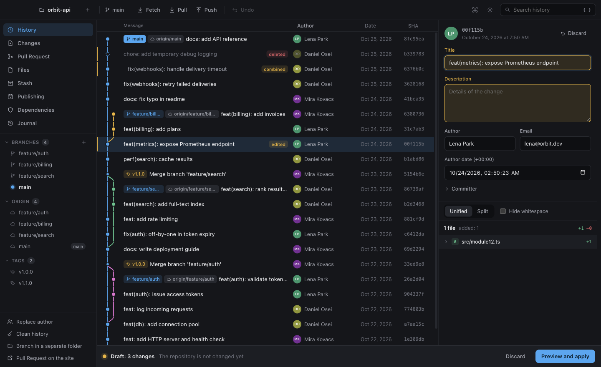
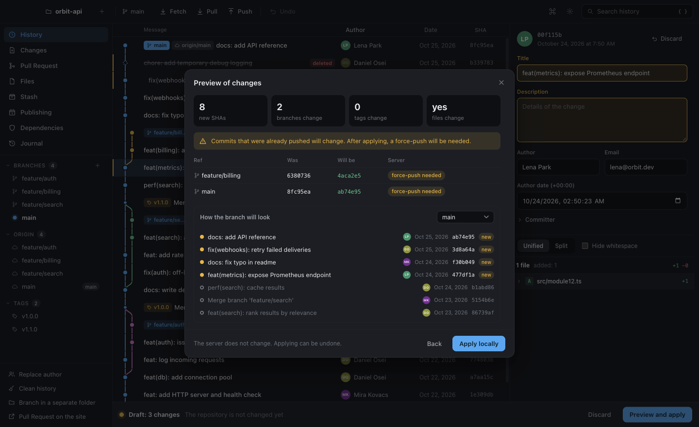
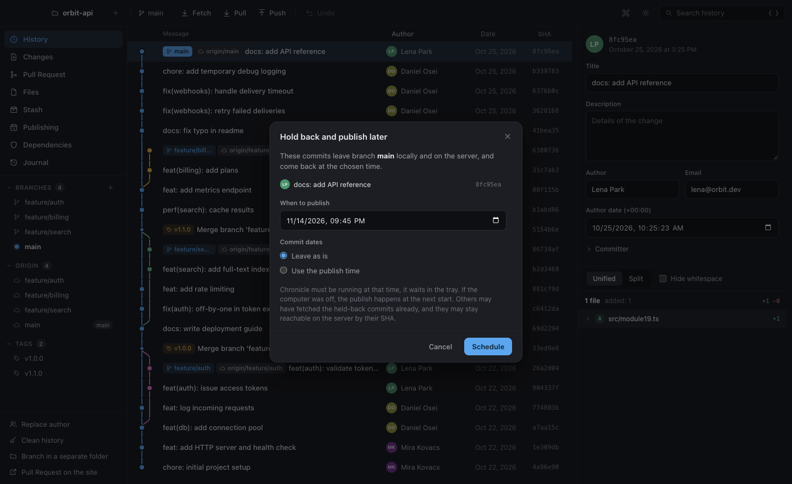
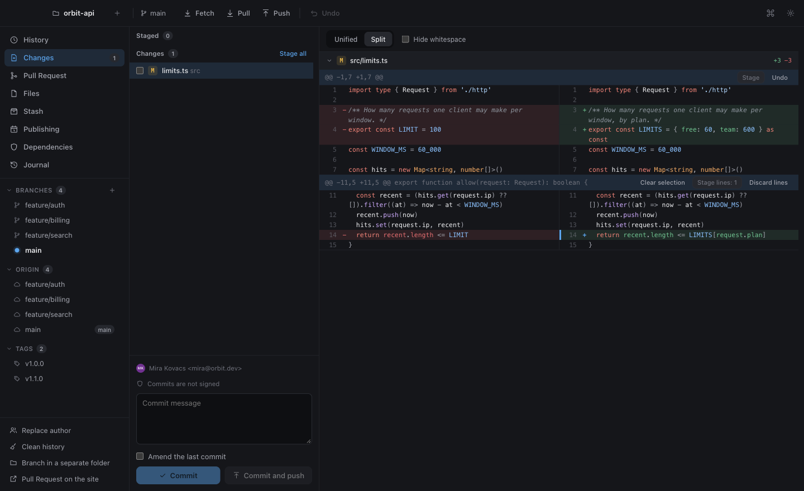
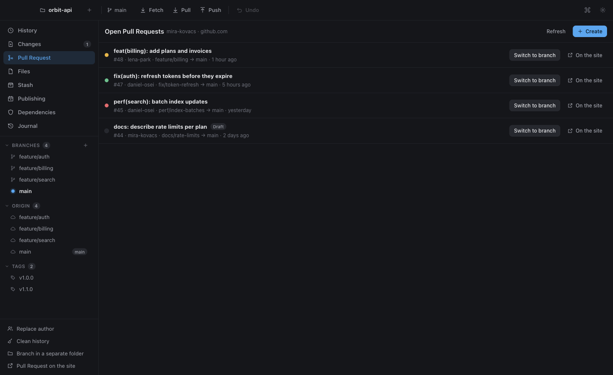
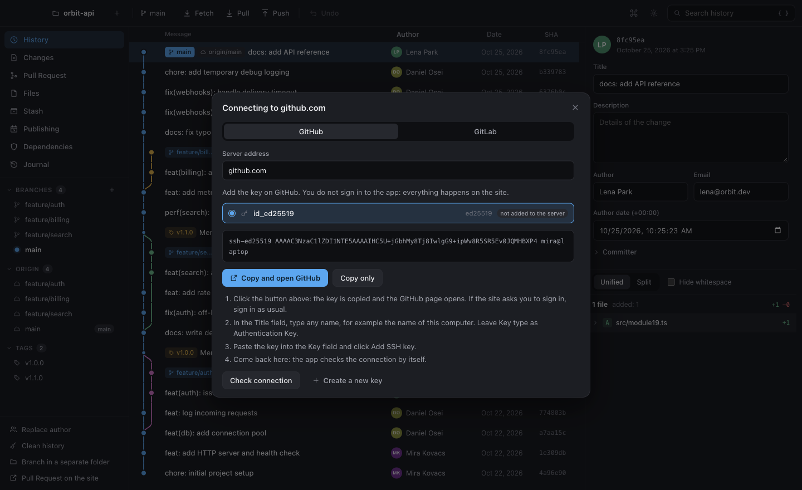

<p align="center">
  
</p>

<h1 align="center">Chronicle</h1>

<p align="center">
  <b>A visual Git history editor for macOS, Windows and Linux.</b><br>
  Rewrite, reorder, squash and schedule commits. See every change before it happens, and undo it afterwards.
</p>

<p align="center">
  <a href="https://github.com/betrayalove/git-gui/releases/latest"></a>
  <a href="https://github.com/betrayalove/git-gui/actions/workflows/ci.yml"></a>
  
</p>

<p align="center">
  <b>English</b> · <a href="README.ru.md">Русский</a>
</p>



## Why Chronicle

Interactive rebase is powerful, but you edit a text file and learn the result afterwards. Chronicle lets you work on the history itself. Edits collect in a draft, the repository stays untouched, and a preview shows exactly which commits, branches and tags will change before anything moves.

## Features

### Edit history

- **Change any commit:** message, author, committer and dates, including commits you have already pushed.
- **Reorder** commits by dragging them.
- **Move a branch onto another** and edit it on the way: reorder, squash or drop commits while the resulting history updates next to the list.
- **Squash, drop and split** commits. Splitting works hunk by hunk.
- **Replace an author** across the whole history.
- **Clean history:** remove files from every commit, or collapse a branch into one commit.
- **Resolve conflicts** caused by a new commit order right in the preview.

### Stay safe

- **Nothing changes until you apply.** The preview builds the real new history without moving any branch, and shows the branch exactly as it will look.
- **Atomic updates.** All branches and tags move together, or none of them do.
- **Undo and redo.** Every rewrite is kept in a journal with backups.
- **Protected force-push.** It uses `--force-with-lease`, so commits someone else pushed meanwhile are not overwritten. You see what appears and what vanishes on the server first.
- **Exact history.** Commits you did not touch keep their bytes and SHA, and old or unusual objects survive a rewrite. This was checked on the full history of `git/git`.

### Publish later

Take the latest commits off a branch, locally and on the server, and publish them at a set time. Chronicle waits in the tray, and checks in advance whether the server will accept the push with nobody at the computer.

### Understand the code

- **Search the changes,** not just the messages: find every commit that added or removed a line with some text, across all branches.
- **File history** that follows renames, with the change made in each version.
- **Blame:** who last changed each line, grouped by commit and shaded by age. One click opens the commit, another shows the file just before it.

### Everyday Git

- **Diffs like in a good editor:** unified or split, with syntax highlighting, an option to hide whitespace-only changes, and before-and-after views of images.
- **Stage by line.** Stage and discard whole files, single hunks, or just the lines you pick.
- **Merge and pull with foresight.** Before merging, Chronicle lists the files that will conflict. Pull offers rebase or merge, and with rebase every conflict is resolved in the preview, before anything changes. Conflicts that do happen open in a built-in editor.
- **.gitignore with a right-click** on a new file: ignore the file, its folder or every file with its extension.
- **Commit signing** with an SSH or GPG key for one repository, without touching global git settings. The app asks for an SSH key passphrase itself, and the inspector shows whether a commit is signed and whether the signature holds.
- **Worktrees:** open another branch in its own folder and switch between them in one click.
- **Submodules** with their state, and **Git LFS** files with download and tracking.
- Commit, push and fetch, stashes, branches and tags, cherry-pick, revert and reset.

### Pull and merge requests

With a GitHub or GitLab token in the settings, open requests show up right in the app along with the state of their CI checks. Switch to the branch of any request, forks included, or create a new one; if the server lacks the branch, Chronicle pushes it first. It works with github.com, GitHub Enterprise, gitlab.com and self-hosted GitLab.

The token is checked with the server before it is saved, kept encrypted in the system password store, and only ever sent to its own server. Without a token, requests open on the site with the branch already selected.

### Work fast

- **Tabs:** several repositories in one window, each with its own draft and view.
- **Command palette** on ⌘K: find a view, an action, a branch or a tab by a few letters.
- **Shortcuts:** views on ⌘1–⌘8, history search ⌘F, settings ⌘,, new tab ⌘T, switching tabs with Ctrl+Tab. Windows and Linux use Ctrl in place of ⌘.
- **Background fetch** every 10 minutes, adjustable in the settings. The counts on Pull and Push stay current, and a background fetch never asks for a key password.

### Check dependencies

Chronicle reads the lockfiles of the latest commit and checks every package against the public databases [OSV.dev](https://osv.dev), [deps.dev](https://deps.dev) and [endoflife.date](https://endoflife.date). Only names and versions of public packages are sent, and only after you agree once.

- **12 lockfile formats in 6 ecosystems:** npm, pnpm and Yarn; Cargo; Go modules; Poetry, uv, Pipenv and `requirements.txt`; Bundler; Composer.
- **Advice by urgency.** Vulnerabilities in code that ships come first, development tools next, then updates that may break your code and updates that should not. Each package shows how the project gets it and the lowest version without the flaw. A malicious package is always at the top.
- **Platform support:** when the version of Electron, React, Vue, Angular, Next.js, Nuxt, Django, Flask, Rails, Laravel or Symfony you use stops being supported.
- **Update on a new branch.** For npm, pnpm, Yarn 2+ and `requirements.txt`, Chronicle makes the change in a separate copy of the repository with install scripts off. It raises a direct dependency, or adds an override for one that another package pins. The result is an ordinary commit on its own branch, and your working folder stays as it is.

### No account needed

Chronicle works through your system Git and the SSH keys on your computer. Local work needs nothing at all. When a server refuses the connection, a helper takes over:

1. It uses a key that already works, with any file name.
2. It asks for the key's password if the key has one.
3. If no key fits, it creates one and walks you through adding it on GitHub or GitLab.

Pushing and fetching always go through git and SSH keys. The token in the settings is only for listing and creating pull and merge requests.

## Screenshots

| Preview before applying | Publish on a timer |
| --- | --- |
|  |  |

| Split diff | Pull requests in the app |
| --- | --- |
|  |  |

| Connecting with an SSH key |
| --- |
|  |

The interface is in English and Russian, with a light and a dark theme. Both are in Settings, and the language follows the system until you pick one.

## Download

Get the latest version from [Releases](https://github.com/betrayalove/git-gui/releases/latest). Chronicle needs [Git](https://git-scm.com/downloads) 2.45 or newer.

| System | Installer | Portable, no installation |
| --- | --- | --- |
| **Windows** x64 | `…-windows-x64-setup.exe` | `…-windows-x64-portable.exe`, `…-windows-x64-portable.zip` |
| **macOS** Apple silicon | `…-macos-arm64.dmg` | `…-macos-arm64-portable.zip` |
| **macOS** Intel | `…-macos-x64.dmg` | `…-macos-x64-portable.zip` |
| **Linux** x64 | `…-linux-x64.deb` | `…-linux-x64.AppImage`, `…-linux-x64-portable.tar.gz` |

The portable `.exe` keeps its data in a `Chronicle Data` folder next to the file. Starting it takes a little longer, because it unpacks itself each time.

### First launch

Builds are not signed with a paid developer certificate yet, so the system warns about them. Updates are announced in the app and installed by hand.

- **macOS:** open the app once, then choose **Open Anyway** in **System Settings → Privacy & Security**. If macOS reports the app as damaged, remove the download mark:

  ```bash
  xattr -dr com.apple.quarantine /Applications/Chronicle.app
  ```

- **Windows:** in the SmartScreen window, choose **More info → Run anyway**.
- **Linux:** the `.deb` package works out of the box. The AppImage needs `libfuse2`, and on Ubuntu 24.04 or newer it also needs Chromium's sandbox to be allowed, so prefer the package there.

## Development

You need Node.js, pnpm and Git 2.45 or newer.

```bash
pnpm install
```

```bash
pnpm dev
```

Check your work. The interface tests start the real app, so a window appears for a moment.

```bash
pnpm typecheck
```

```bash
pnpm test
```

```bash
pnpm test:e2e
```

Build for the current system into `dist/`:

```bash
pnpm dist:mac
```

```bash
pnpm dist:win
```

```bash
pnpm dist:linux
```

### Project layout

| Path | Contents |
| --- | --- |
| `src/core` | Git logic in plain Node: reading, rewriting, scheduling, SSH |
| `src/shared` | Types and pure logic used on both sides |
| `src/main` | Electron main process: window, IPC, tray |
| `src/preload` | The narrow bridge to the interface |
| `src/renderer` | React interface, with no access to Node |
| `tests`, `e2e` | Tests on temporary repositories, and tests of the real app |

The reasoning behind the design is in [docs/DESIGN.md](docs/DESIGN.md), in Russian.

### Releasing

Set the new version in `package.json`, commit it, and push a matching tag:

```bash
git tag v1.2.0
```

```bash
git push origin v1.2.0
```

[The release workflow](.github/workflows/release.yml) builds the installers for all three systems and portable versions, starts them to check they work, and publishes a GitHub release with checksums. A tag with a suffix, such as `v1.2.0-beta.1`, becomes a pre-release.

## Contributing

Ideas and plans are in [docs/ROADMAP.md](docs/ROADMAP.md), in Russian. Read [CODESTYLE.md](CODESTYLE.md) first. It describes how code is written here and how changes are checked, for people and AI agents alike.
