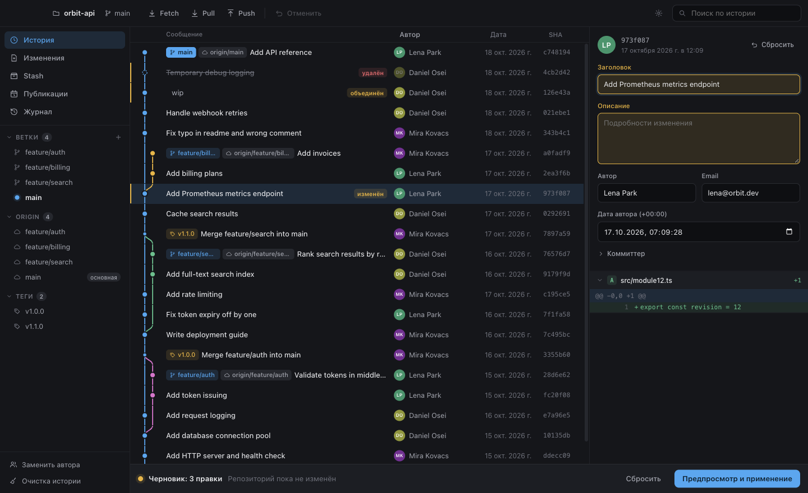
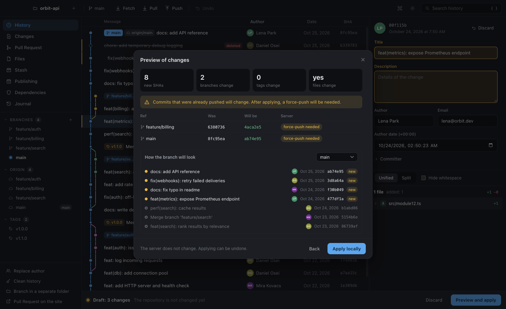
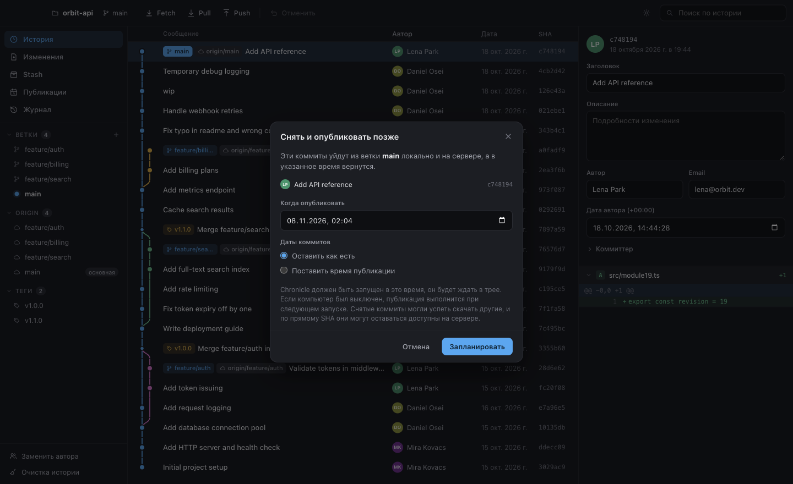
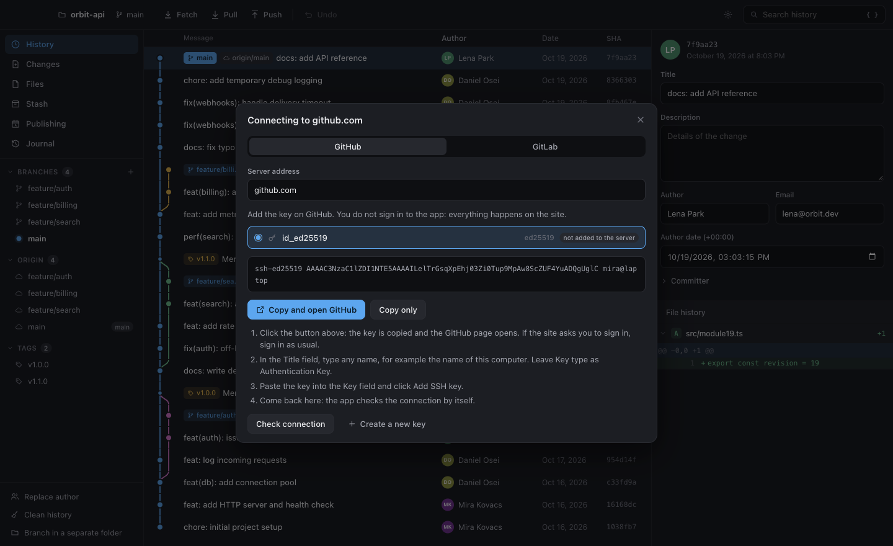

<p align="center">
  
</p>

<h1 align="center">Chronicle</h1>

<p align="center">
  <b>Визуальный редактор истории Git для macOS, Windows и Linux.</b><br>
  Переписывайте, переставляйте, объединяйте и публикуйте коммиты по таймеру. Каждое изменение видно заранее, и его можно отменить.
</p>

<p align="center">
  <a href="https://github.com/betrayalove/git-gui/releases/latest"></a>
  <a href="https://github.com/betrayalove/git-gui/actions/workflows/ci.yml"></a>
  
</p>

<p align="center">
  <a href="README.md">English</a> · <b>Русский</b>
</p>

<picture>
  <source media="(prefers-color-scheme: dark)" srcset="docs/images/history-dark.png">
  <source media="(prefers-color-scheme: light)" srcset="docs/images/history-light.png">
  
</picture>

## Зачем нужен Chronicle

Интерактивный rebase мощный, но вы правите текстовый файл и узнаёте результат уже потом. В Chronicle вы работаете с самой историей. Правки собираются в черновик, репозиторий при этом не меняется, а предпросмотр точно показывает, какие коммиты, ветки и теги изменятся, ещё до применения.

## Возможности

### Правка истории

- **Любой коммит:** сообщение, автор, коммиттер и даты, в том числе у уже запушенных коммитов.
- **Порядок:** коммиты переставляются перетаскиванием.
- **Объединение, удаление и разделение** коммитов. Разделять можно по отдельным кускам изменений.
- **Замена автора** во всей истории.
- **Очистка истории:** удаление файлов из всех коммитов или сборка ветки в один коммит.
- **Конфликты** из-за нового порядка коммитов разрешаются прямо в предпросмотре.

### Безопасность

- **До применения ничего не меняется.** Предпросмотр строит настоящую новую историю, не сдвигая ни одной ветки.
- **Атомарность.** Все ветки и теги меняются вместе или не меняются вообще.
- **Отмена и повтор.** Каждая правка хранится в журнале вместе с резервными копиями.
- **Защищённый force-push.** Он идёт через `--force-with-lease`, поэтому чужие коммиты, появившиеся за это время, не перезапишутся. Заранее видно, что появится на сервере и что исчезнет.
- **Точность.** Коммиты, которых правка не касается, сохраняют свои байты и SHA, а старые и необычные объекты переживают переписывание. Это проверено на полной истории `git/git`.

### Публикация по таймеру

Снимите последние коммиты с ветки, локально и на сервере, и опубликуйте их в нужное время. Chronicle ждёт в трее и заранее проверяет, примет ли сервер отправку, когда за компьютером никого нет.

### Повседневная работа

Commit, push, pull и fetch. Добавление в индекс отдельных кусков. Управление stash, ветками и тегами, включая переименование ветки на сервере. Cherry-pick, revert и reset. Встроенный просмотр изменений.

### Аккаунт не нужен

Chronicle работает через системный Git и SSH-ключи вашего компьютера. Локальной работе не нужно вообще ничего. Если сервер отказал в подключении, включается помощник:

1. Он использует ключ, который уже работает, с любым именем файла.
2. Он спросит пароль ключа, если пароль есть.
3. Если подходящего ключа нет, он создаст новый и подскажет, как добавить его на GitHub или GitLab.

Pull Request и Merge Request открываются на сайте с уже выбранной веткой.

## Скриншоты

| Предпросмотр перед применением | Публикация по таймеру |
| --- | --- |
|  |  |

| Подключение через SSH-ключ |
| --- |
|  |

## Скачать

Последняя версия лежит в разделе [Releases](https://github.com/betrayalove/git-gui/releases/latest). Для работы нужен [Git](https://git-scm.com/downloads) 2.45 или новее.

| Система | Установщик | Portable, без установки |
| --- | --- | --- |
| **Windows** x64 | `…-windows-x64-setup.exe` | `…-windows-x64-portable.exe`, `…-windows-x64-portable.zip` |
| **macOS** Apple silicon | `…-macos-arm64.dmg` | `…-macos-arm64-portable.zip` |
| **macOS** Intel | `…-macos-x64.dmg` | `…-macos-x64-portable.zip` |
| **Linux** x64 | `…-linux-x64.deb` | `…-linux-x64.AppImage`, `…-linux-x64-portable.tar.gz` |

Portable-версия `.exe` хранит данные в папке `Chronicle Data` рядом с файлом. Запускается она чуть дольше, потому что каждый раз распаковывает себя.

### Первый запуск

Сборки пока не подписаны платным сертификатом разработчика, поэтому система предупреждает о них. О новых версиях приложение сообщает само, а устанавливаются они вручную.

- **macOS:** откройте приложение один раз, затем выберите **Всё равно открыть** в **Системные настройки → Конфиденциальность и безопасность**. Если macOS пишет, что приложение повреждено, снимите отметку о загрузке:

  ```bash
  xattr -dr com.apple.quarantine /Applications/Chronicle.app
  ```

- **Windows:** в окне SmartScreen выберите **Подробнее → Выполнить в любом случае**.
- **Linux:** пакет `.deb` работает сразу. AppImage нужен `libfuse2`, а в Ubuntu 24.04 и новее ещё и разрешение для песочницы Chromium, поэтому там лучше ставить пакет.

## Разработка

Нужны Node.js, pnpm и Git 2.45 или новее.

```bash
pnpm install
```

```bash
pnpm dev
```

Проверка. Тесты интерфейса запускают настоящее приложение, поэтому на экране ненадолго появляется окно.

```bash
pnpm typecheck
```

```bash
pnpm test
```

```bash
pnpm test:e2e
```

Сборка для текущей системы в папку `dist/`:

```bash
pnpm dist:mac
```

```bash
pnpm dist:win
```

```bash
pnpm dist:linux
```

### Устройство проекта

| Путь | Содержимое |
| --- | --- |
| `src/core` | Логика Git на чистом Node: чтение, переписывание, расписание, SSH |
| `src/shared` | Типы и чистая логика для обеих сторон |
| `src/main` | Основной процесс Electron: окно, IPC, трей |
| `src/preload` | Узкий мост к интерфейсу |
| `src/renderer` | Интерфейс на React без доступа к Node |
| `tests`, `e2e` | Тесты на временных репозиториях и тесты настоящего приложения |

Обоснование решений описано в [docs/DESIGN.md](docs/DESIGN.md).

### Выпуск версии

Укажите новую версию в `package.json`, закоммитьте и отправьте такой же тег:

```bash
git tag v1.2.0
```

```bash
git push origin v1.2.0
```

[Процесс выпуска](.github/workflows/release.yml) соберёт установщики и portable-версии для всех трёх систем, запустит их для проверки и опубликует выпуск на GitHub с контрольными суммами. Тег с суффиксом, например `v1.2.0-beta.1`, станет предварительным выпуском.

## Участие в разработке

Идеи и планы собраны в [docs/ROADMAP.md](docs/ROADMAP.md). Перед началом прочитайте [CODESTYLE.md](CODESTYLE.md). Там описано, как здесь пишется код и как проверяются изменения, и для людей, и для ИИ-агентов.
